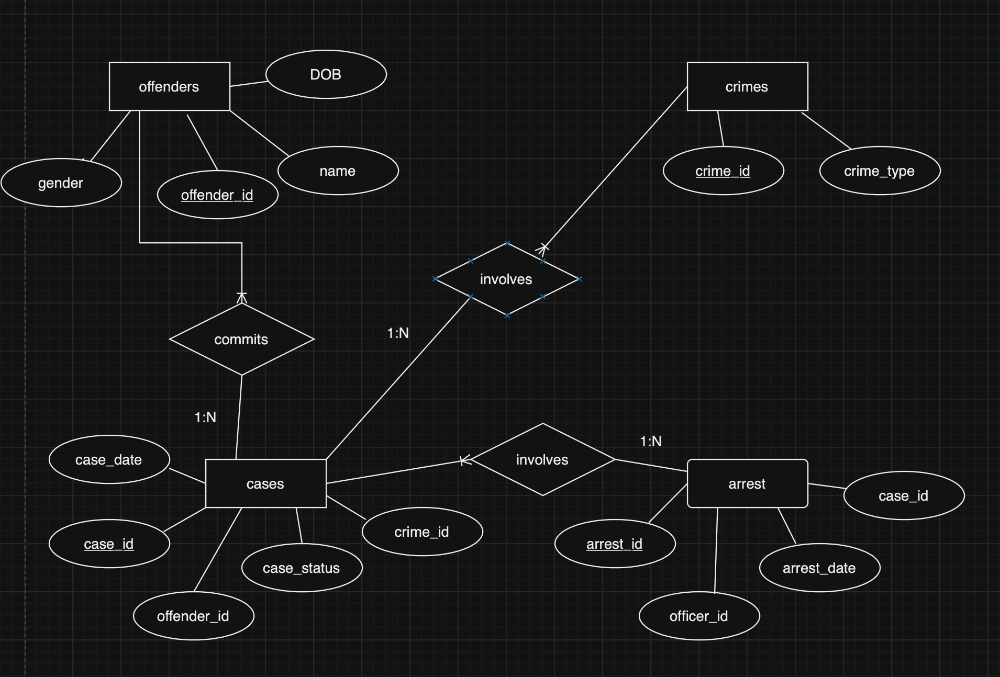
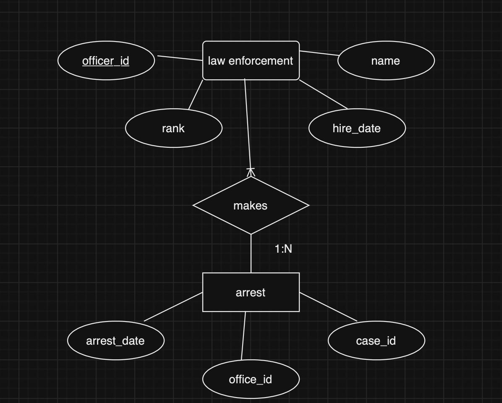
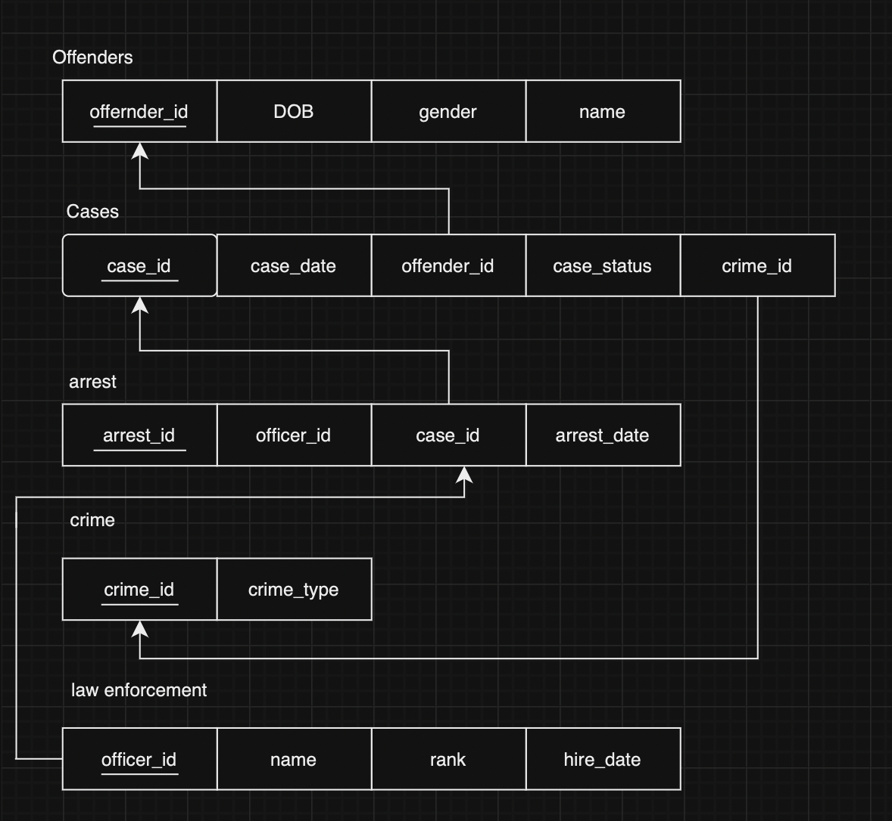
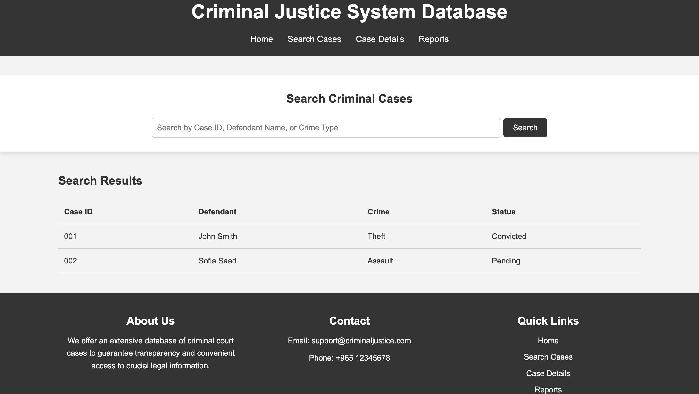

# ⚖️ Criminal Justice System Database

## Relational Database Design, SQL Analysis & Web Interface

The **Criminal Justice System Database** is an individual database project developed for **CMPS342 at Beirut Arab University**.

The project focuses on designing a structured relational database for organizing information related to criminal cases, offenders, crimes, arrests, and law-enforcement officers.

It combines:

- 🗄️ Relational database design
- 🧩 Entity-Relationship modeling
- 🔗 Table relationships
- 🔑 Primary and foreign keys
- 💻 SQL queries
- 📊 Data retrieval and analysis
- 🌐 HTML/CSS interface prototype

The goal was to create an organized system where criminal-case information could be stored, related, searched, and analyzed efficiently.

---

# 📌 Project Overview

Criminal justice systems manage large amounts of related information.

A single criminal case may involve:

```text
Offender
   +
Crime
   +
Case
   +
Arrest
   +
Law-Enforcement Officer
```

Keeping this information in unrelated files can make searching and analyzing records difficult.

This project solves that problem conceptually by designing a **relational database** in which related information is stored in separate tables and connected through keys.

The system was designed to support information such as:

- Offender details
- Crime types
- Criminal cases
- Case status
- Case dates
- Arrest information
- Arrest dates
- Law-enforcement officers
- Officer ranks
- Officer involvement in arrests

---

# ✨ Project Highlights

- 🗄️ Relational database design
- 🧩 Entity-Relationship Diagram
- 🔗 Relational schema
- 🔑 Primary and foreign key relationships
- 👤 Offender management
- 🚨 Crime information
- ⚖️ Case management
- 👮 Law-enforcement records
- ⛓️ Arrest tracking
- 💻 SQL query design
- 🔎 Case-search concept
- 📊 Data retrieval and aggregation
- 🌐 HTML/CSS interface prototype
- 📄 Complete technical documentation

---

# 👩‍💻 My Contribution

I was responsible for the **complete design, implementation, analysis, documentation, and interface prototype for this project**.

My work included:

- Selecting the Criminal Justice System as the database domain
- Identifying the required entities
- Defining entity attributes
- Designing the Entity-Relationship Diagram
- Defining relationships between entities
- Designing the relational schema
- Identifying primary keys
- Defining foreign-key relationships
- Designing the database structure
- Creating and testing SQL queries
- Working with SELECT operations
- Applying filtering conditions
- Joining related tables
- Sorting query results
- Grouping database information
- Performing aggregate analysis
- Designing the website interface
- Developing the website using HTML and CSS
- Creating a criminal-case search interface
- Designing a sample results table
- Preparing project diagrams
- Preparing the complete project report

This project allowed me to apply database concepts from initial system analysis through relational design, querying, and interface prototyping.

---

# 🎯 Project Objectives

The main objectives of the project were to:

- Design a relational database for criminal-justice information
- Identify the entities required by the system
- Model relationships between those entities
- Create an Entity-Relationship Diagram
- Transform the ER design into a relational schema
- Use primary and foreign keys to maintain relationships
- Apply SQL Data Manipulation Language concepts
- Retrieve information using SQL queries
- Join information from multiple tables
- Filter and organize case information
- Analyze data using aggregate queries
- Design a simple interface for accessing criminal-case information

---

# 🗄️ Database Design

The database is centered around five main entities:

```text
Offenders
Crimes
Cases
Arrests
Law Enforcement
```

These entities are connected to represent the relationships found in a criminal-justice system.

```text
             Offenders
                 │
                 │ commits
                 ▼
                Cases
               /     \
              /       \
             ▼         ▼
          Crimes     Arrests
                        │
                        │ made by
                        ▼
                Law Enforcement
```

---

# 👤 Offenders

The `Offenders` entity stores information about individuals involved in criminal cases.

Main attributes include:

```text
offender_id
name
DOB
gender
```

The identifier:

```text
offender_id
```

acts as the primary key.

An offender can be associated with criminal cases through the `Cases` table.

---

# 🚨 Crimes

The `Crimes` entity stores the different types of crimes represented in the system.

Main attributes include:

```text
crime_id
crime_type
```

The primary key is:

```text
crime_id
```

Each case references a crime through its `crime_id`.

---

# ⚖️ Cases

The `Cases` entity stores information about individual criminal cases.

Main attributes include:

```text
case_id
case_date
offender_id
case_status
crime_id
```

The primary key is:

```text
case_id
```

The table also contains references to:

```text
offender_id
crime_id
```

which connect each case to an offender and a crime.

---

# ⛓️ Arrests

The `Arrests` entity records arrests connected to criminal cases.

Main attributes include:

```text
arrest_id
officer_id
case_id
arrest_date
```

The primary key is:

```text
arrest_id
```

The table links:

```text
Officer
   +
Case
```

through:

```text
officer_id
case_id
```

---

# 👮 Law Enforcement

The `Law Enforcement` entity stores information about officers.

Main attributes include:

```text
officer_id
name
rank
hire_date
```

The primary key is:

```text
officer_id
```

Officers are linked to arrests through the officer identifier.

---

# 🔗 Database Relationships

The main relationships are:

```text
Offenders
    │
    │ offender_id
    ▼
Cases
```

```text
Crimes
   │
   │ crime_id
   ▼
Cases
```

```text
Cases
   │
   │ case_id
   ▼
Arrests
```

```text
Law Enforcement
       │
       │ officer_id
       ▼
     Arrests
```

Together, these relationships make it possible to combine information from multiple tables when executing SQL queries.

---

# 🧩 Entity-Relationship Diagram

The Entity-Relationship Diagram models the major entities, attributes, and relationships used in the system.



A second section of the ER model represents the relationship between law-enforcement officers and arrests.



The ER design helped define the structure of the database before creating the relational schema.

---

# 🔗 Relational Schema

The ER design was transformed into a relational structure showing the database tables, fields, primary keys, and relationships.



The relational schema includes:

```text
Offenders
Cases
Crimes
Arrests
Law Enforcement
```

Foreign keys allow records from these tables to be combined efficiently.

---

# 💻 SQL Querying

After designing the database, SQL queries were used to retrieve and analyze the stored information.

The project applies concepts such as:

- `SELECT`
- `WHERE`
- `ORDER BY`
- `INSERT`
- `UPDATE`
- `DELETE`
- Table joins
- Aggregate functions
- Filtering
- Grouping
- Counting records

---

# 🔎 Example Database Questions

The project explores questions such as:

### 👤 Offender Information

```text
What are the details of all offenders?
```

This requires retrieving offender records from the database.

---

### 🚨 Crime Listing

```text
Which crimes are available in the system?
```

Crime information can be retrieved and sorted according to crime type.

---

### ⚖️ Case Status

```text
What is the status of each case together with
the offender and crime information?
```

This requires combining multiple related tables.

Conceptually:

```text
Cases
  +
Offenders
  +
Crimes
      │
      ▼
Combined Case Information
```

---

### ✅ Convicted Cases

The system can filter records according to case status.

Example:

```text
Case Status = Convicted
```

---

### 🚨 Cases by Crime Type

Cases can also be filtered according to the type of crime involved.

Example:

```text
Crime Type = Assault
```

---

### 👮 Officer Case Count

The system can analyze how many cases or arrests are associated with each officer.

```text
Officer
   │
   ▼
Arrests
   │
   ▼
COUNT
```

This demonstrates aggregation and grouping.

---

### 📅 Investigation Date Filtering

Cases can be filtered according to:

```text
Case Status
+
Case Date
```

This allows queries such as identifying investigations occurring after a particular date.

---

### 🔗 Offender and Officer Relationships

By joining:

```text
Offenders
Cases
Arrests
Law Enforcement
```

the database can determine relationships such as which offenders were arrested by a particular officer.

---

### 🏆 Officer with Most Arrests

Aggregate queries can count arrests for each officer and determine which officer has the highest total.

```text
Law Enforcement
       │
       ▼
     Arrests
       │
       ▼
GROUP BY Officer
       │
       ▼
COUNT Arrests
       │
       ▼
Highest Result
```

---

# 🧠 Database Concepts Applied

This project demonstrates several important relational-database concepts.

## 🔑 Primary Keys

Each main table contains an identifier used to uniquely identify its records.

Examples:

```text
offender_id
crime_id
case_id
arrest_id
officer_id
```

---

## 🔗 Foreign Keys

Foreign keys are used to connect related records.

Examples include:

```text
Cases.offender_id
        ↓
Offenders.offender_id
```

and:

```text
Arrests.case_id
        ↓
Cases.case_id
```

These relationships help maintain structured connections between records.

---

## 🔄 Joins

Joins allow information from multiple tables to be combined.

For example:

```text
Cases
  +
Offenders
  +
Crimes
      │
      ▼
Case ID
Offender Name
Crime Type
Case Status
```

---

## 🔍 Filtering

Conditions can be used to retrieve only records that satisfy specific requirements.

Examples:

```text
Convicted cases
Cases after a particular date
Assault cases
Cases involving a specific officer
```

---

## 📊 Aggregation

Aggregate functions allow the database to summarize information.

For example:

```text
Number of arrests per officer
```

requires counting related arrest records.

---

# 🌐 Website Interface

The project also includes a simple **HTML and CSS interface prototype** for presenting criminal-case information.

The interface contains:

- Navigation bar
- Case-search field
- Search button
- Search-results table
- Case ID
- Defendant
- Crime
- Status
- About section
- Contact section
- Quick links



---

# 🔎 Search Interface

The website includes a search field designed around the idea of searching by:

```text
Case ID
Defendant Name
Crime Type
```

Example interface:

```text
Search Criminal Cases

[ Search by Case ID, Defendant Name, or Crime Type ]

                       [ Search ]
```

---

# 📋 Search Results Interface

The prototype displays sample case results in a table.

The table contains:

```text
Case ID
Defendant
Crime
Status
```

Conceptually:

```text
┌─────────┬────────────┬─────────┬───────────┐
│ Case ID │ Defendant  │ Crime   │ Status    │
├─────────┼────────────┼─────────┼───────────┤
│ ...     │ ...        │ ...     │ ...       │
└─────────┴────────────┴─────────┴───────────┘
```

This demonstrates how information from the database could eventually be presented through a user-facing system.

---

# 🗺️ Planned User Navigation

The system design considered pages and functionality such as:

```text
Homepage
   │
   ├── Search Page
   │       │
   │       ├── Results
   │       │
   │       └── Case Details
   │
   ├── Advanced Search
   │
   ├── About
   │
   └── Contact
```

The uploaded implementation focuses on the main interface prototype rather than implementing all of these pages as a complete dynamic web application.

---

# 🏗️ Complete Project Workflow

```text
Identify System Requirements
           │
           ▼
     Identify Entities
           │
           ▼
   Define Attributes
           │
           ▼
Design Entity-Relationship Diagram
           │
           ▼
Design Relational Schema
           │
           ▼
Define Primary & Foreign Keys
           │
           ▼
   Design SQL Queries
           │
           ▼
Retrieve & Analyze Data
           │
           ▼
Design HTML/CSS Interface
           │
           ▼
 Document the System
```

---

# 🛠️ Technologies & Concepts

## 🗄️ Database

- Relational Database Design
- SQL
- Entity-Relationship Modeling
- Relational Schema Design
- Primary Keys
- Foreign Keys
- Table Relationships

## 💻 SQL Concepts

- SELECT
- INSERT
- UPDATE
- DELETE
- WHERE
- ORDER BY
- JOIN operations
- Aggregate queries
- Grouping
- Filtering

## 🌐 Frontend

- HTML5
- CSS3

## 🧠 Database Concepts

- Data modeling
- Entity relationships
- Referential relationships
- Data organization
- Query design
- Data retrieval
- Data analysis

---

# 📂 Project Structure

```text
criminal-justice-system/
│
├── README.md
│
├── website/
│   ├── Project.html
│   └── styles.css
│
├── diagrams/
│   ├── er-diagram.png
│   ├── er-diagram-2.png
│   └── relational-schema.png
│
├── screenshots/
│   └── website.png
│
└── documentation/
    ├── Report.pdf
    └── Project-Description.pdf
```

---

# 📁 Explore the Project

## 🌐 Website Prototype

View the HTML/CSS interface created to demonstrate how criminal-case information could be presented to users.

[**View Website Source →**](./website/)

---

## 📄 HTML

View the main website page.

[**View HTML →**](./website/Project.html)

---

## 🎨 CSS

View the website styling.

[**View CSS →**](./website/styles.css)

---

## 🧩 Entity-Relationship Diagram

View the database ER diagrams.

[**View ER Diagram →**](./diagrams/er-diagram.png)

---

## 🔗 Relational Schema

View the relational database structure.

[**View Relational Schema →**](./diagrams/relational-schema.png)

---

## 📸 Website Screenshot

View the completed interface prototype.

[**View Website Screenshot →**](./screenshots/website.png)

---

## 📄 Project Report

The report documents:

- Project motivation
- Database objectives
- Website concept
- ER design
- Relational schema
- Database relationships
- SQL querying
- Query explanations
- Results
- Conclusion

[**View Report →**](./documentation/Report.pdf)

---

## 📝 Project Description

View the original project-description document.

[**View Project Description →**](./documentation/Project-Description.pdf)

---

# 💡 What I Learned

Developing the Criminal Justice System Database gave me practical experience designing a relational database from the initial problem definition through database modeling and querying.

Through this project, I gained experience with:

- Database requirement analysis
- Entity identification
- Attribute definition
- ER diagram design
- Relational-schema design
- Primary keys
- Foreign keys
- Table relationships
- SQL querying
- Data filtering
- Sorting
- Joining multiple tables
- Aggregate analysis
- Database reasoning
- Website interface design
- HTML
- CSS
- Technical documentation

One of the most valuable parts of the project was understanding how separate tables can work together to represent a larger real-world system without storing all information in one structure.

---

# ⚠️ Project Scope

This project primarily focuses on **database modeling, relational design, SQL querying, and interface prototyping**.

The included website is a static HTML/CSS demonstration.

The current uploaded version does **not** connect the search interface directly to a live SQL database.

Features such as:

- Dynamic database search
- Server-side query execution
- Case-detail generation
- User authentication
- Advanced search
- Database-backed reports

represent possible extensions of the design rather than functionality implemented in the included frontend prototype.

---

# 🔮 Future Improvements

The project could be expanded by:

- Creating a complete SQL script in a dedicated database file
- Connecting the interface to MySQL
- Adding a PHP or other backend service
- Implementing live case searches
- Adding advanced filtering
- Creating dynamic case-detail pages
- Adding officer-management interfaces
- Adding crime-management interfaces
- Adding arrest-management interfaces
- Creating administrator authentication
- Adding role-based access
- Implementing form validation
- Building database reports
- Adding pagination for large result sets
- Improving database indexing
- Adding additional constraints
- Improving accessibility and responsive design

---

# 🎓 Academic Context

**CMPS342 Database Project**  
**Beirut Arab University**

**Supervisor:** Dr. Julie Bu Daher  
**Teaching Assistant:** Lynn Al Arwadi

This project was completed as an **individual database course project**.

## 👩‍💻 My Role

I was responsible for the complete project, including:

- System concept
- Database analysis
- Entity identification
- ER diagram design
- Relational schema design
- Database relationships
- SQL query design
- Query analysis
- Website prototype
- HTML implementation
- CSS implementation
- Project diagrams
- Technical documentation
- Final report

---

## 🔗 Project Navigation

[**🌐 Website →**](./website/) · [**🧩 ER Diagram →**](./diagrams/er-diagram.png) · [**🔗 Relational Schema →**](./diagrams/relational-schema.png) · [**📄 Report →**](./documentation/Report.pdf)
