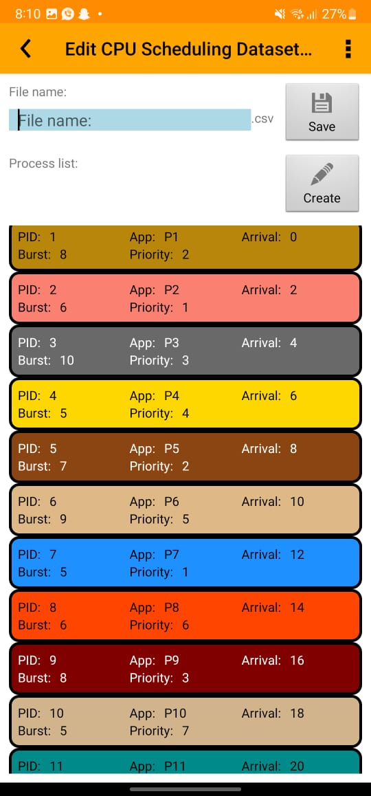
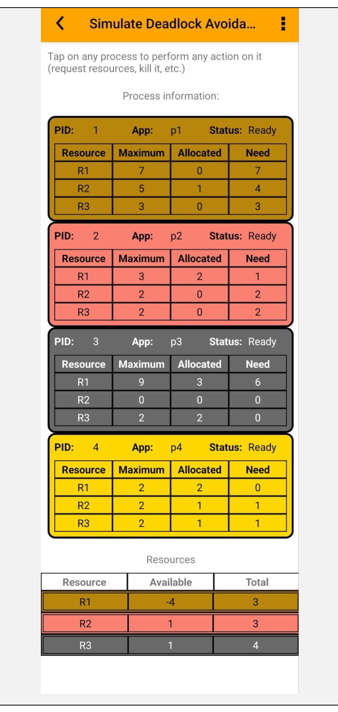

# ⚙️ FCFS Scheduling & Banker’s Algorithm

## Operating Systems Scheduling and Deadlock Avoidance Simulation

This project was developed for the **Operating Systems (CMPS442)** course at **Beirut Arab University**.

The project uses an **Operating Systems Algorithm Simulator** to explore two fundamental Operating Systems concepts:

- 🖥️ **First Come First Served (FCFS) CPU Scheduling**
- 🔒 **Banker’s Algorithm for Deadlock Avoidance**

The project combines theoretical Operating Systems concepts with step-by-step simulation, calculations, performance analysis, and interpretation of system behavior.

---

# 📌 Project Overview

The project contains two main parts.

## Part A — FCFS Scheduling

A simulation containing **12 processes** was configured with different:

- Arrival times
- Burst times
- Priorities

The processes were executed using the **First Come First Served scheduling algorithm**.

The simulation was analyzed to determine:

- Process execution order
- Finish times
- Turnaround times
- Waiting times
- Average waiting time
- Effects of long CPU bursts on later processes

---

## Part B — Banker’s Algorithm

A second simulation was created to explore **deadlock avoidance** using Banker’s Algorithm.

The system contains:

```text
4 Processes
3 Resource Types
```

The project involved:

- Maximum Matrix
- Allocation Matrix
- Available Vector
- Need Matrix calculation
- Safety Algorithm
- Safe-sequence determination

The final simulation confirmed that the system was in a **safe state**.

---

# ✨ Project Highlights

- 🖥️ FCFS CPU Scheduling simulation
- 🔢 12-process scheduling experiment
- ⏱️ Waiting Time calculation
- 🔄 Turnaround Time calculation
- 📊 Process performance analysis
- 🚚 Convoy effect observation
- 🔒 Banker’s Algorithm simulation
- 🧮 Need Matrix calculation
- 🛡️ Deadlock avoidance analysis
- ✅ Safe-state verification
- 🔗 Safe-sequence calculation
- 📸 Step-by-step simulator screenshots
- 📄 Complete technical report
- 🎤 Project presentation

---

# 👩‍💻 My Contribution

I was responsible for the **complete simulation, analysis, calculations, documentation, and presentation of this project**.

My work included:

- Configuring the Operating Systems simulator
- Creating the FCFS scheduling experiment
- Configuring 12 processes
- Assigning process arrival times
- Assigning burst times
- Assigning priorities
- Running the FCFS simulation step by step
- Documenting each stage of process execution
- Calculating finish times
- Calculating turnaround times
- Calculating waiting times
- Calculating average waiting time
- Analyzing the convoy effect
- Configuring the Banker’s Algorithm experiment
- Defining Maximum and Allocation matrices
- Defining the Available resource vector
- Calculating the Need Matrix
- Applying the safety algorithm
- Determining the safe sequence
- Verifying whether the system was in a safe state
- Interpreting the Operating Systems behavior
- Preparing the complete project report
- Preparing the project presentation

The project helped connect theoretical Operating Systems concepts with practical simulation and system analysis.

---

# 🖥️ Part A — First Come First Served Scheduling

## What is FCFS?

**First Come First Served (FCFS)** is a non-preemptive CPU scheduling algorithm.

Processes are executed according to the order in which they arrive.

```text
First Process to Arrive
        │
        ▼
   Gets the CPU
        │
        ▼
Runs Until Completion
        │
        ▼
Next Process in Queue
```

Once a process starts executing, it continues until its CPU burst is complete.

---

# 🔄 FCFS Scheduling Workflow

```text
Processes Arrive
      │
      ▼
Enter Ready Queue
      │
      ▼
Ordered by Arrival Time
      │
      ▼
First Process Gets CPU
      │
      ▼
Process Runs Until Completion
      │
      ▼
Next Process Gets CPU
      │
      ▼
Continue Until All Finish
```

Because FCFS is non-preemptive, a running process is not interrupted by another process that arrives later.

---

# 📋 Process Configuration

The experiment contains **12 processes**.

| Process | Arrival Time | Burst Time | Priority |
|---|---:|---:|---:|
| P1 | 0 | 8 | 2 |
| P2 | 2 | 6 | 1 |
| P3 | 4 | 10 | 3 |
| P4 | 6 | 5 | 4 |
| P5 | 8 | 7 | 2 |
| P6 | 10 | 9 | 5 |
| P7 | 12 | 5 | 1 |
| P8 | 14 | 6 | 6 |
| P9 | 16 | 8 | 3 |
| P10 | 18 | 5 | 7 |
| P11 | 20 | 7 | 4 |
| P12 | 22 | 5 | 2 |

Although priority values are included in the process configuration, **FCFS determines execution order using arrival time rather than priority**.

---

# ⏱️ FCFS Execution

At time:

```text
0
```

only:

```text
P1
```

is available.

Therefore, P1 receives the CPU first.

Because FCFS is non-preemptive:

```text
P1 executes from Time 0 → Time 8
```

During this period, additional processes arrive and are placed at the end of the ready queue.

Once P1 finishes:

```text
P2
```

receives the CPU.

This continues until all 12 processes have completed.

---

# 📊 FCFS Timeline

The resulting execution order is:

```text
P1
 ↓
P2
 ↓
P3
 ↓
P4
 ↓
P5
 ↓
P6
 ↓
P7
 ↓
P8
 ↓
P9
 ↓
P10
 ↓
P11
 ↓
P12
```

The CPU executes the processes sequentially according to arrival order.

---

# 🧮 Scheduling Formulas

Two important scheduling metrics were calculated.

## Turnaround Time

```text
Turnaround Time
=
Finish Time − Arrival Time
```

Turnaround Time represents the total amount of time from when a process arrives until it completes.

---

## Waiting Time

```text
Waiting Time
=
Turnaround Time − Burst Time
```

Waiting Time represents how long a process spends waiting before receiving CPU execution.

---

# 📈 FCFS Results

The simulation produced the following results:

| Process | Arrival | Burst | Finish | Turnaround Time | Waiting Time |
|---|---:|---:|---:|---:|---:|
| P1 | 0 | 8 | 8 | 8 | 0 |
| P2 | 2 | 6 | 14 | 12 | 6 |
| P3 | 4 | 10 | 24 | 20 | 10 |
| P4 | 6 | 5 | 29 | 23 | 18 |
| P5 | 8 | 7 | 36 | 28 | 21 |
| P6 | 10 | 9 | 45 | 35 | 26 |
| P7 | 12 | 5 | 50 | 38 | 33 |
| P8 | 14 | 6 | 56 | 42 | 36 |
| P9 | 16 | 8 | 64 | 48 | 40 |
| P10 | 18 | 5 | 69 | 51 | 46 |
| P11 | 20 | 7 | 76 | 56 | 49 |
| P12 | 22 | 5 | 81 | 59 | 54 |

---

# 📊 Average Waiting Time

The waiting times were:

```text
P1   = 0
P2   = 6
P3   = 10
P4   = 18
P5   = 21
P6   = 26
P7   = 33
P8   = 36
P9   = 40
P10  = 46
P11  = 49
P12  = 54
```

The resulting average waiting time was:

```text
28.25 time units
```

---

# 🚚 Convoy Effect

An important behavior observed during the simulation was the **convoy effect**.

The convoy effect occurs when a long-running process causes several shorter processes behind it to wait.

For example, processes with longer burst times such as:

```text
P3 → Burst Time 10

P6 → Burst Time 9
```

increase the waiting time for processes that are behind them.

Conceptually:

```text
Long Process
     │
     ▼
Occupies CPU
     │
     ▼
Shorter Processes Wait
     │
     ▼
Waiting Time Increases
```

This demonstrates one of the disadvantages of FCFS scheduling.

---

# ✅ Advantages of FCFS

FCFS has several advantages:

- Simple to understand
- Easy to implement
- Uses arrival order
- Fair according to arrival time
- Low scheduling complexity

---

# ⚠️ Limitations of FCFS

The simulation also demonstrates important weaknesses:

- Long processes can delay shorter processes
- Waiting times can become large
- Turnaround times increase for later processes
- Convoy effect may occur
- The algorithm does not prioritize shorter processes

Because of these limitations, FCFS may not always provide efficient CPU utilization for workloads containing processes with very different burst times.

---

# 🔒 Part B — Banker’s Algorithm

## Deadlock Avoidance

The second part of the project explores **Banker’s Algorithm**.

Banker’s Algorithm is a deadlock-avoidance technique that determines whether allocating resources to processes will keep the system in a **safe state**.

Before granting resources, the algorithm checks whether a sequence exists in which every process can complete safely.

---

# 💀 Deadlock

A deadlock can occur when processes are waiting for resources held by other processes, preventing any of them from continuing.

Conceptually:

```text
Process A
   │
   │ waits for
   ▼
Resource 2
   ▲
   │ held by
Process B
   │
   │ waits for
   ▼
Resource 1
   ▲
   │ held by
Process A
```

Banker’s Algorithm attempts to avoid this situation by ensuring the system remains safe before resources are allocated.

---

# 🏦 Banker’s Algorithm Inputs

The project uses:

```text
4 Processes

P1
P2
P3
P4
```

and:

```text
3 Resource Types

R1
R2
R3
```

The algorithm requires:

- Maximum Matrix
- Allocation Matrix
- Available Vector

From these values, the:

```text
Need Matrix
```

is calculated.

---

# 📊 Maximum Matrix

The Maximum Matrix represents the maximum number of each resource type that each process may require.

| Process | R1 | R2 | R3 |
|---|---:|---:|---:|
| P1 | 7 | 5 | 3 |
| P2 | 3 | 2 | 2 |
| P3 | 9 | 0 | 2 |
| P4 | 2 | 2 | 2 |

---

# 📦 Allocation Matrix

The Allocation Matrix represents the resources already assigned to each process.

| Process | R1 | R2 | R3 |
|---|---:|---:|---:|
| P1 | 0 | 1 | 0 |
| P2 | 2 | 0 | 0 |
| P3 | 3 | 0 | 2 |
| P4 | 2 | 1 | 1 |

---

# 🟢 Available Vector

The resources currently available are:

```text
R1 = 3

R2 = 3

R3 = 4
```

Therefore:

```text
Available = [3, 3, 4]
```

---

# 🧮 Need Matrix

The Need Matrix represents how many additional resources each process may still require.

The formula is:

```text
Need = Maximum − Allocation
```

For example:

```text
P1

Maximum:
[7, 5, 3]

Allocation:
[0, 1, 0]

Need:
[7, 4, 3]
```

---

# 📊 Calculated Need Matrix

| Process | R1 | R2 | R3 |
|---|---:|---:|---:|
| P1 | 7 | 4 | 3 |
| P2 | 1 | 2 | 2 |
| P3 | 6 | 0 | 0 |
| P4 | 0 | 1 | 1 |

---

# 🛡️ Safety Algorithm

The safety algorithm begins using:

```text
Work = Available

Work = [3, 3, 4]
```

The algorithm searches for a process where:

```text
Need ≤ Work
```

If such a process exists, it can complete.

Once it completes, the resources allocated to that process are released and added back to `Work`.

---

# 🔄 Safe-State Workflow

```text
Available Resources
        │
        ▼
Find Process Where
Need ≤ Work
        │
        ▼
Process Can Complete
        │
        ▼
Release Its Resources
        │
        ▼
Increase Work Vector
        │
        ▼
Find Next Process
        │
        ▼
Repeat Until All Complete
```

If all processes can complete, the system is in a **safe state**.

---

# ✅ Step 1 — P2

Initial:

```text
Work = [3, 3, 4]
```

P2 needs:

```text
Need(P2) = [1, 2, 2]
```

Since:

```text
[1, 2, 2] ≤ [3, 3, 4]
```

P2 can complete.

Its allocation is:

```text
[2, 0, 0]
```

After P2 completes:

```text
Work =
[3, 3, 4]
+
[2, 0, 0]

= [5, 3, 4]
```

---

# ✅ Step 2 — P4

Now:

```text
Work = [5, 3, 4]
```

P4 needs:

```text
[0, 1, 1]
```

P4 can complete.

Its allocation:

```text
[2, 1, 1]
```

is returned.

New Work:

```text
[5, 3, 4]
+
[2, 1, 1]

= [7, 4, 5]
```

---

# ✅ Step 3 — P1

Now:

```text
Work = [7, 4, 5]
```

P1 needs:

```text
[7, 4, 3]
```

The required resources are available.

P1 completes and releases:

```text
[0, 1, 0]
```

New Work:

```text
[7, 4, 5]
+
[0, 1, 0]

= [7, 5, 5]
```

---

# ✅ Step 4 — P3

Finally:

```text
Work = [7, 5, 5]
```

P3 needs:

```text
[6, 0, 0]
```

P3 can complete.

Its allocation:

```text
[3, 0, 2]
```

is released.

Final Work:

```text
[7, 5, 5]
+
[3, 0, 2]

= [10, 5, 7]
```

All processes can therefore finish safely.

---

# 🔗 Safe Sequence

The resulting safe sequence is:

```text
P2
 ↓
P4
 ↓
P1
 ↓
P3
```

or:

```text
P2 → P4 → P1 → P3
```

Therefore:

# ✅ The system is in a safe state.

---

# 📊 Banker’s Safety Table

| Step | Process | Need | Work Before | Allocation Returned | Work After |
|---:|---|---|---|---|---|
| 1 | P2 | `[1,2,2]` | `[3,3,4]` | `[2,0,0]` | `[5,3,4]` |
| 2 | P4 | `[0,1,1]` | `[5,3,4]` | `[2,1,1]` | `[7,4,5]` |
| 3 | P1 | `[7,4,3]` | `[7,4,5]` | `[0,1,0]` | `[7,5,5]` |
| 4 | P3 | `[6,0,0]` | `[7,5,5]` | `[3,0,2]` | `[10,5,7]` |

---

# 🧠 FCFS vs Banker’s Algorithm

Although both algorithms were studied in the same project, they solve different Operating Systems problems.

| Area | FCFS | Banker’s Algorithm |
|---|---|---|
| Main Problem | CPU Scheduling | Deadlock Avoidance |
| Input | Processes | Processes + Resources |
| Focus | CPU execution order | Safe resource allocation |
| Main Concept | Arrival order | Safe state |
| Important Data | Arrival & Burst Time | Maximum, Allocation, Available |
| Main Output | Waiting & Turnaround Time | Need Matrix & Safe Sequence |
| Key Result | Average WT = 28.25 | P2 → P4 → P1 → P3 |

---

# 📸 Simulation Screenshots

The project includes screenshots documenting the FCFS scheduling simulation from initial configuration through completion.

## FCFS Initial Configuration



---

## FCFS Simulation

The simulation was recorded step by step as processes moved through execution and the ready queue.

[**View All FCFS Screenshots →**](./screenshots/fcfs/)

---

## Banker’s Algorithm



The Banker’s simulation demonstrates the Maximum, Allocation, Need, and resource-availability information used to determine whether the system is safe.

---

# 🛠️ Concepts & Tools Used

## ⚙️ Operating Systems

- CPU Scheduling
- Process Management
- Ready Queues
- Non-Preemptive Scheduling
- Deadlock
- Deadlock Avoidance
- Resource Allocation
- Safe States

## 🖥️ Scheduling

- First Come First Served
- Arrival Time
- Burst Time
- Finish Time
- Waiting Time
- Turnaround Time
- Convoy Effect

## 🔒 Resource Management

- Banker’s Algorithm
- Maximum Matrix
- Allocation Matrix
- Available Vector
- Need Matrix
- Safety Algorithm
- Safe Sequence

## 🔧 Tools

- OS Algorithm Simulator
- Android
- Microsoft Word
- Microsoft PowerPoint

---

# 📂 Project Structure

```text
operating-systems-scheduling/
│
├── README.md
│
├── screenshots/
│   ├── bankers-algorithm.png
│   │
│   └── fcfs/
│       ├── 1.jpeg
│       ├── 2.jpeg
│       ├── 3.jpeg
│       ├── ...
│       └── 15.jpeg
│
└── documentation/
    ├── Report.pdf
    ├── Presentation.pdf
    └── Project-Manual.pdf
```

---

# 📁 Explore the Project

## 📸 FCFS Simulation

View the step-by-step screenshots of the 12-process FCFS simulation.

[**View FCFS Screenshots →**](./screenshots/fcfs/)

---

## 🔒 Banker’s Algorithm

View the Banker’s Algorithm simulation screenshot.

[**View Banker’s Simulation →**](./screenshots/bankers-algorithm.png)

---

## 📄 Project Report

The complete report contains:

- Simulator description
- Project objectives
- FCFS configuration
- FCFS simulation steps
- Screenshots
- Scheduling calculations
- Waiting Time analysis
- Turnaround Time analysis
- Banker’s Algorithm
- Need Matrix
- Safety algorithm
- Safe sequence
- Discussion
- Conclusion

[**View Report →**](./documentation/Report.pdf)

---

## 🎤 Project Presentation

The presentation summarizes the FCFS and Banker’s Algorithm experiments and results.

[**View Presentation →**](./documentation/Presentation.pdf)

---

# 💡 What I Learned

This project gave me practical experience applying theoretical **Operating Systems concepts through simulation and analysis**.

Through the project, I worked with:

- CPU scheduling
- FCFS
- Process arrival times
- CPU burst times
- Ready queues
- Waiting Time
- Turnaround Time
- Process execution order
- Convoy effect
- Resource allocation
- Deadlock avoidance
- Banker’s Algorithm
- Need Matrix calculations
- Safe-state analysis
- Safe-sequence determination
- Simulator-based experimentation
- Result interpretation
- Technical documentation

One of the most valuable parts of the project was seeing how scheduling and resource-management algorithms behave step by step rather than studying only their theoretical definitions.

The FCFS simulation demonstrated how long processes can increase waiting times for later processes, while Banker’s Algorithm demonstrated how Operating Systems can evaluate resource allocations before allowing processes to continue.

---

# ⚠️ Project Scope

This project focuses on **Operating Systems simulation and analysis**.

The algorithms were explored using an Operating Systems simulator rather than being implemented as standalone source-code programs.

The project demonstrates:

- Algorithm configuration
- Simulation
- Mathematical calculations
- Process analysis
- Deadlock analysis
- Result interpretation

rather than software implementation of the algorithms themselves.

---

# 🎓 Academic Context

**Operating Systems — CMPS442**  
**Beirut Arab University**

This project was completed as an **individual Operating Systems course project**.

## 👩‍💻 My Role

I was responsible for the complete project, including:

- FCFS experiment setup
- Process configuration
- Simulator execution
- Step-by-step documentation
- Scheduling calculations
- Waiting Time analysis
- Turnaround Time analysis
- FCFS result interpretation
- Convoy-effect analysis
- Banker’s Algorithm configuration
- Need Matrix calculation
- Safe-state analysis
- Safe-sequence determination
- Simulator screenshots
- Project documentation
- Project presentation

---

## 🔗 Project Navigation

[**📸 FCFS Simulation →**](./screenshots/fcfs/) · [**🔒 Banker’s Algorithm →**](./screenshots/bankers-algorithm.png) · [**📄 Report →**](./documentation/Report.pdf) · [**🎤 Presentation →**](./documentation/Presentation.pdf)
