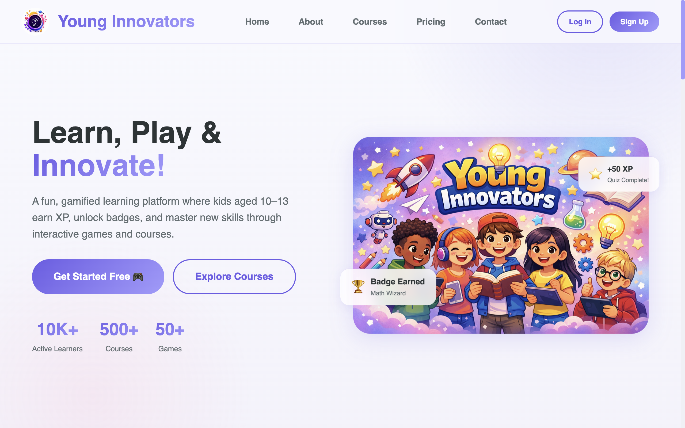
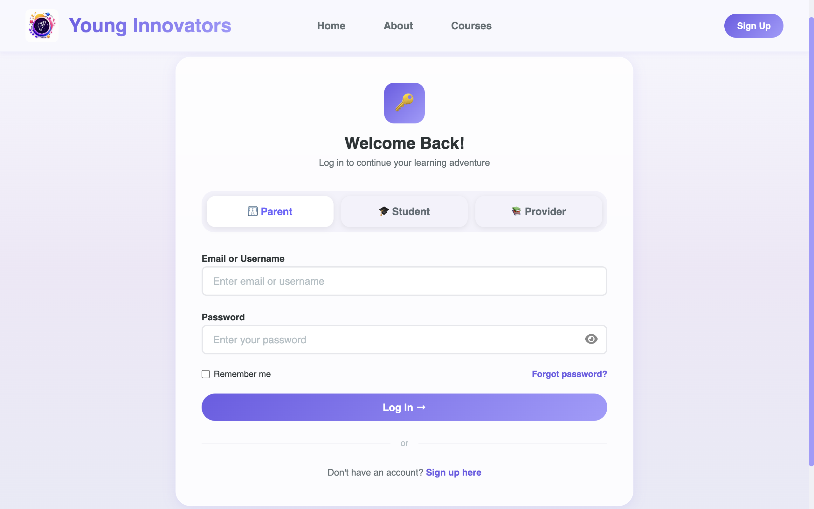
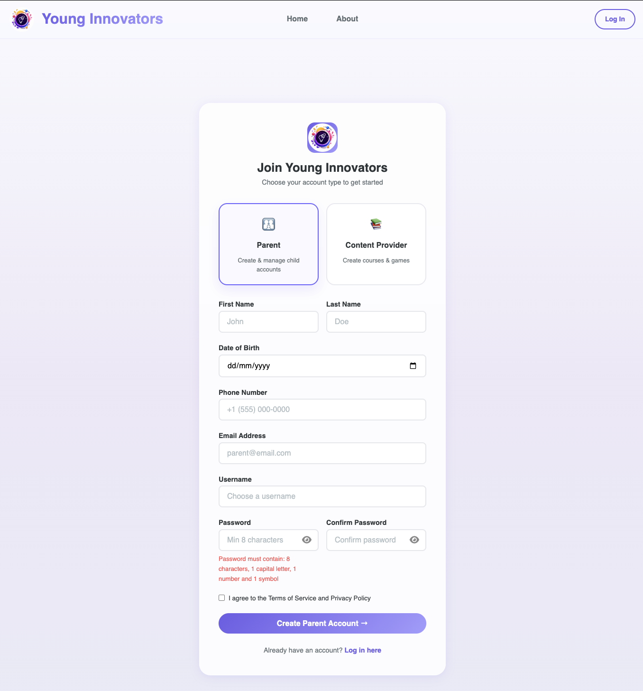
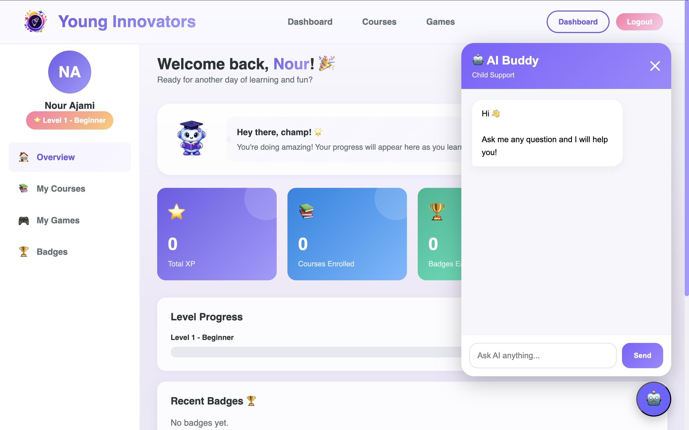
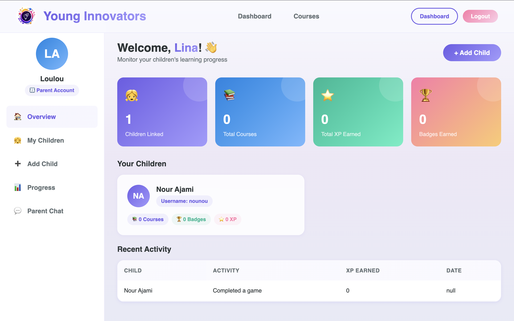
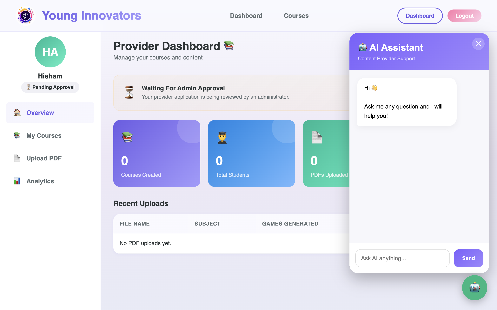
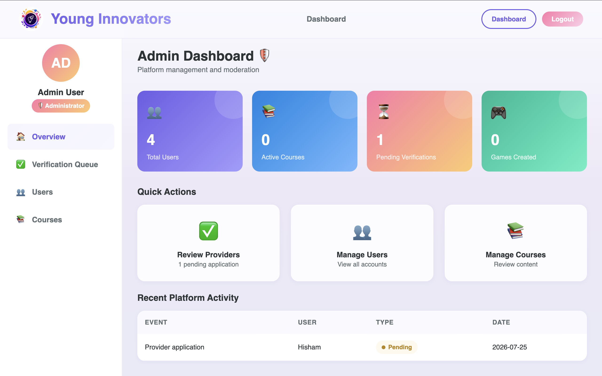

# 🎓 Young Innovators

## AI-Powered Gamified Learning Management System

**Young Innovators** is a full-stack educational platform developed as a **Computer Science Senior Project at Beirut Arab University**.

The platform was designed to make learning more engaging for young students by combining **Artificial Intelligence, gamification, interactive educational games, progress tracking, and role-based learning experiences**.

One of the platform's main features is an AI-powered workflow that transforms educational material uploaded as a **PDF into interactive game content**.

---

## ✨ Project Highlights

- 🤖 AI-powered PDF-to-game generation
- 🎮 Interactive educational games
- 🧠 Student AI Learning Buddy
- 👨‍🏫 Content Provider AI Assistant
- 📚 Course creation and enrollment
- 🏆 XP, levels, badges, and progress tracking
- 👨‍👩‍👧 Parent progress monitoring
- 👨‍💼 Administrator management dashboard
- 🔐 Role-based authentication
- 🌐 Full-stack web platform

---

# 🤖 My Contribution

Young Innovators was developed as a **team senior project**.

My primary responsibility focused on the **Artificial Intelligence components** of the platform and their integration into the web system.

### My work included:

- Developing the **AI-powered PDF-to-game generation pipeline**
- Processing uploaded educational PDF files using Python
- Extracting lesson content using **pdfplumber**
- Integrating the **OpenAI API**
- Designing prompts to transform lesson material into structured educational content
- Generating structured game data that could be used by interactive game templates
- Connecting AI-generated content with the educational games
- Working on the **Student AI Learning Buddy**
- Working on the **Content Provider AI Assistant**
- Creating role-specific AI behavior for students and educators
- Connecting Python AI services to the web platform using **Flask APIs**
- Integrating the PDF upload and game-generation process into the website
- Testing and debugging the AI workflow
- Contributing to parts of the website and system integration

---

# 🧠 PDF-to-Game AI Pipeline

One of my main responsibilities was developing the workflow that converts educational PDF material into interactive learning content.

```text
Educational PDF
      │
      ▼
Content Provider Upload
      │
      ▼
PDF Text Extraction
   (pdfplumber)
      │
      ▼
   OpenAI API
      │
      ▼
AI-Generated Questions
and Educational Content
      │
      ▼
Structured Game Data
      │
      ▼
Interactive Game Template
      │
      ▼
Playable Learning Game
```

### How the Pipeline Works

#### 1. PDF Upload

A Content Provider uploads educational material through the platform.

The uploaded PDF acts as the source material for generating the educational content used inside the games.

#### 2. Text Extraction

The PDF is processed using **Python and pdfplumber** to extract the lesson text.

The extracted content is then prepared for AI processing.

#### 3. AI Processing

The lesson content is sent to the **OpenAI API** using structured prompts designed to generate educational questions and learning content based on the uploaded material.

#### 4. Structured Game Data

The AI-generated response is transformed into structured data that can be understood by the game templates.

This separates the educational content from the game itself, allowing the same game template to work with different lessons.

#### 5. Interactive Game

The generated content is connected to the selected game template, producing an interactive learning activity based on the uploaded PDF.

[**Explore the AI System →**](./AI/)

---

# 🎮 Educational Games

Young Innovators includes multiple interactive game templates designed to work with educational content generated through the PDF-to-Game pipeline.

## 🔐 Escape Room

Students progress through themed stages by answering educational questions generated from the uploaded lesson material.

The game combines learning content with progression and hints to make the experience more interactive.

## 🥊 Boxing Game

The Boxing Game combines educational questions with a boxing-themed learning experience.

Students answer lesson-based questions while progressing through the game.

## 🐍 Snake Game

The Snake Game integrates educational content into a Snake-style interactive experience.

Students interact with answers while playing, combining traditional gameplay with lesson-based learning.

## ✏️ Fill in the Blank

The Fill in the Blank activity asks students to complete missing words or concepts based on the educational material.

---

## 🔄 Dynamic Game Content

The game templates are separated from the educational content.

This allows the same game to be reused with different lessons generated from different PDFs.

```text
Game Template
      +
AI-Generated Lesson Data
      │
      ▼
Interactive Educational Game
```

[**Explore the Educational Games →**](./games/)

---

# 🤖 AI Assistants

Young Innovators also includes two AI assistants designed for different user roles.

## 🧒 Student AI Learning Buddy

The **Student Learning Buddy** is designed to support younger learners while using the platform.

The assistant uses role-specific AI instructions designed to:

- Explain concepts using simple language
- Provide clear and understandable explanations
- Guide students step by step
- Use examples when explaining concepts
- Encourage students throughout the learning process
- Keep responses focused on educational topics
- Support learning rather than acting as a general-purpose chatbot

[**View Student Assistant Code →**](./AI/student-assistant/)

---

## 👨‍🏫 Content Provider AI Assistant

The **Content Provider AI Assistant** is designed to support educators while preparing educational material and interactive learning activities.

The assistant can support tasks related to:

- Understanding educational content
- Identifying important lesson concepts
- Organizing learning material
- Supporting lesson preparation
- Planning educational activities
- Preparing content for game generation

The Content Provider Assistant uses its own role-specific AI configuration separate from the Student Learning Buddy.

[**View Provider Assistant Code →**](./AI/provider-assistant/)

---

# 🔀 Role-Specific AI Design

The platform uses different AI behavior depending on the type of user.

```text
                 Young Innovators AI
                         │
             ┌───────────┴───────────┐
             │                       │
             ▼                       ▼
     Student Assistant       Content Provider
                               Assistant
             │                       │
             ▼                       ▼
 Simple Explanations        Content Preparation
 Learning Guidance          Lesson Organization
 Educational Examples       Activity Planning
 Student Support            Game Preparation
```

This allows each assistant to provide functionality appropriate for its intended user.

---

# 👥 Platform Roles

Young Innovators provides different functionality depending on the user's role.

## 👨‍🎓 Student

Students can:

- Browse available courses
- Enroll in courses
- Access educational games
- Track learning progress
- Earn XP
- Earn badges
- View achievements
- Access the Student AI Learning Buddy

---

## 👨‍👩‍👧 Parent

Parents can:

- Link child accounts
- Monitor student learning progress
- View enrolled courses
- Follow learning activity
- View progress and achievements

---

## 👨‍🏫 Content Provider

Content Providers can:

- Create and manage courses
- Upload educational PDF material
- Generate educational content using AI
- Select educational game experiences
- Manage learning content
- Access the Content Provider AI Assistant
- View platform and course information

---

## 👨‍💼 Administrator

Administrators can:

- Manage users
- Manage platform content
- Manage Content Providers
- Review platform information
- Monitor platform activity

---

# 🏗️ System Architecture

Young Innovators combines a web platform, database, AI services, and interactive educational games.

```text
                    Young Innovators
                           │
          ┌────────────────┼────────────────┐
          │                │                │
          ▼                ▼                ▼
      Frontend          Backend          AI Services
 HTML / CSS / JS          PHP             Python
          │                │                │
          │                ▼                ▼
          │             MySQL          OpenAI API
          │                │                │
          └────────────────┼────────────────┘
                           │
                           ▼
                  Educational Games
```

This architecture allows the website, backend, database, AI functionality, and games to operate as parts of one platform.

---

# 🛠️ Technologies Used

## 🤖 Artificial Intelligence

- Python
- OpenAI API
- Prompt Engineering
- pdfplumber
- Flask
- Flask-CORS
- python-dotenv

## 🌐 Frontend

- HTML5
- CSS3
- JavaScript

## ⚙️ Backend

- PHP
- Python Flask APIs
- API-based communication

## 🗄️ Database

- MySQL
- phpMyAdmin

## 🎮 Game Development

- HTML
- CSS
- JavaScript
- Structured AI-generated game data

## 🔧 Development Tools

- Git
- GitHub
- Visual Studio Code
- MAMP
- XAMPP

---

# 📸 Project Screenshots

## 🏠 Home Page



---

## 🔐 Login Page



---

## 📝 Registration Page



---

## 👨‍🎓 Student Dashboard



---

## 👨‍👩‍👧 Parent Dashboard



---

## 👨‍🏫 Content Provider Dashboard



---

## 👨‍💼 Administrator Dashboard



---

# 📂 Explore the Project

### 🤖 Artificial Intelligence

PDF-to-game generation, AI assistants, prompt engineering, PDF processing, OpenAI integration, and AI/web integration.

[**View AI Components →**](./AI/)

---

### 🎮 Educational Games

Interactive game templates designed to work with AI-generated educational content.

[**View Educational Games →**](./games/)

---

### 🌐 Frontend

Platform interfaces for Students, Parents, Content Providers, and Administrators.

[**View Frontend →**](./frontend/)

---

### ⚙️ Backend

PHP backend functionality supporting authentication, users, courses, progress tracking, role-based features, and database integration.

[**View Backend →**](./backend/)

---

### 📸 Screenshots

Screenshots showcasing the platform and its main user interfaces.

[**View Screenshots →**](./screenshots/)

---

# 💡 What I Learned

Working on Young Innovators gave me practical experience integrating **Artificial Intelligence into a complete software platform** rather than using AI as a standalone feature.

Through this project, I gained hands-on experience with:

- OpenAI API integration
- Prompt engineering
- PDF processing and text extraction
- Structuring AI-generated output
- Flask API development
- Connecting Python AI services with a web application
- Role-specific AI assistant design
- Dynamic educational content generation
- Connecting AI-generated content with interactive game templates
- Frontend and backend integration
- Database-driven web development
- Testing and debugging multi-component applications

One of the most valuable parts of the project was developing a workflow where AI-generated information could be transformed into **structured data that directly powers interactive learning experiences**.

---

# 🎓 Academic Context

**Computer Science Senior Project**  
**Beirut Arab University**

Young Innovators was developed collaboratively as a team project.

## 👩‍💻 My Primary Focus

My primary contribution focused on:

**Artificial Intelligence • PDF-to-Game Generation • AI Assistants • AI/Web Integration**

I also contributed to parts of the website and the integration between the platform's AI services, web interfaces, backend functionality, and educational games.

---

> **Note:** Young Innovators was developed collaboratively as a team Senior Project. The **My Contribution** section above identifies the areas I personally focused on.

---

## 🔗 Project Navigation

[**🤖 AI Components →**](./AI/) · [**🎮 Games →**](./games/) · [**🌐 Frontend →**](./frontend/) · [**⚙️ Backend →**](./backend/) · [**📸 Screenshots →**](./screenshots/)
